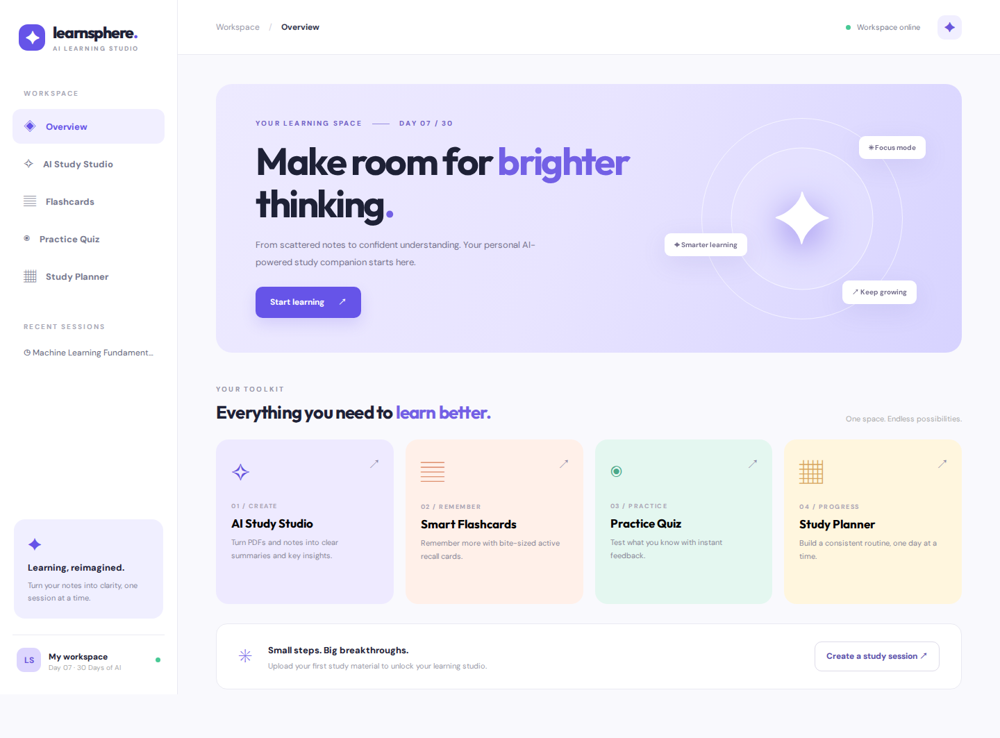
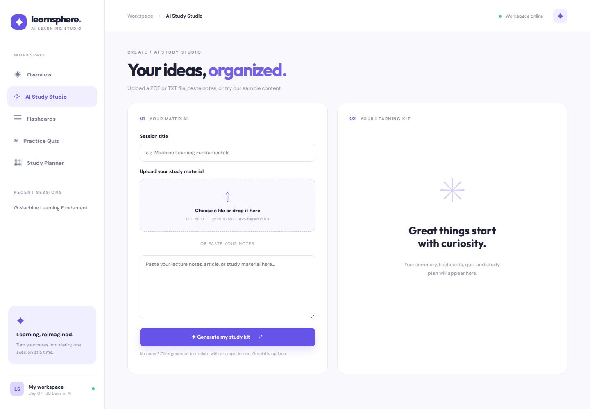
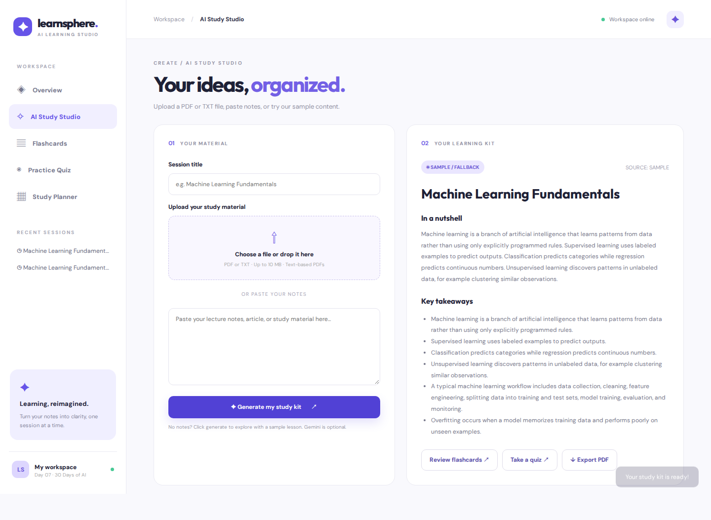
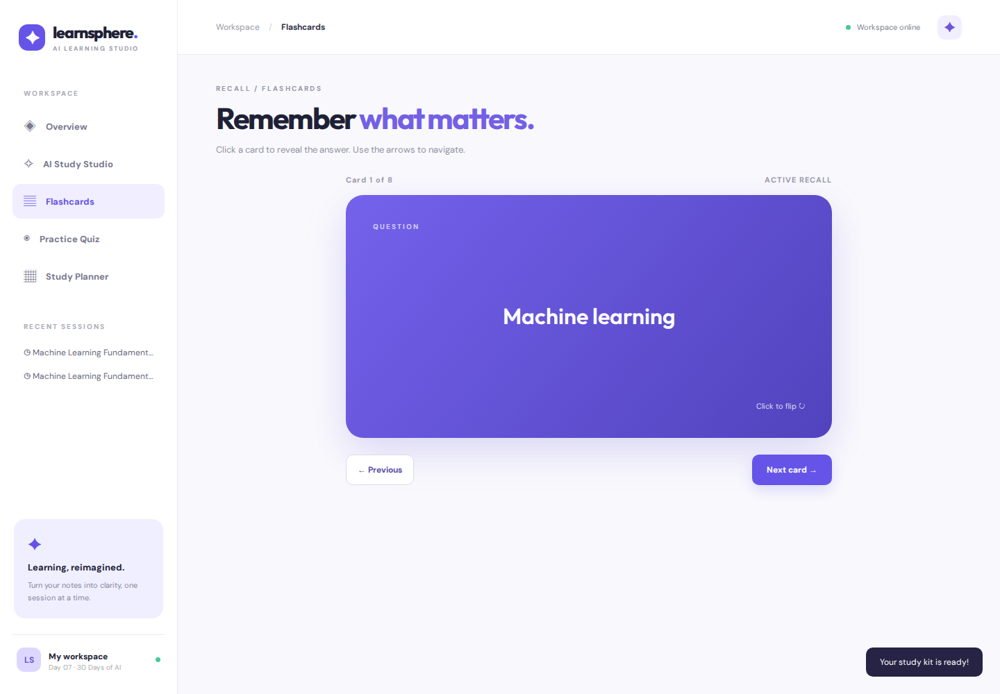
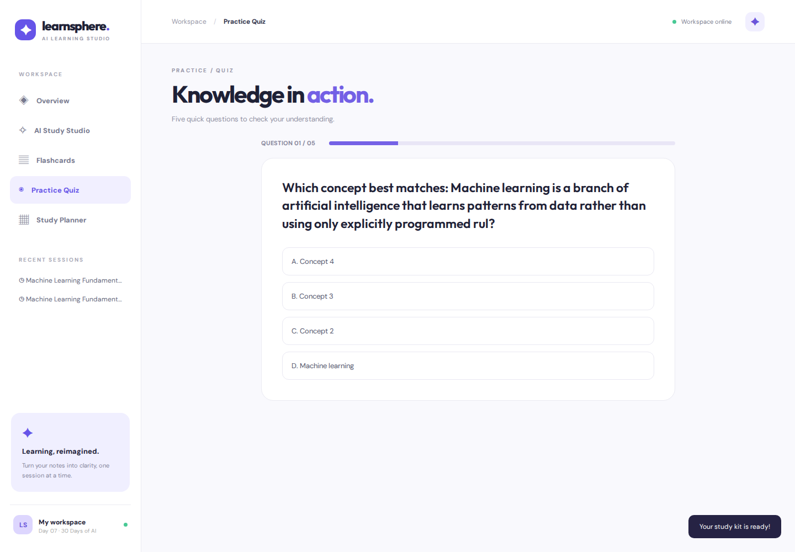
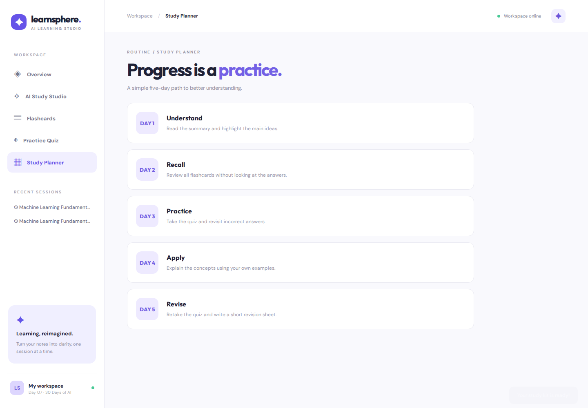

# ✦ LearnSphere AI — Day 07/30

**Turn study materials into understanding.** A polished, responsive AI learning studio built with Flask, vanilla JavaScript and CSS.

## Features
- Premium multi-view dashboard and mobile-friendly navigation
- Upload **text-based PDFs** or TXT files, or paste notes
- AI-generated study summaries and key takeaways
- Interactive flip flashcards and scored multiple-choice quizzes
- Five-day personalized study plan
- Saved sessions in SQLite and downloadable PDF study guides
- **No API key needed:** sample/fallback mode derived from source text
- **Optional Gemini:** set `GEMINI_API_KEY` for more tailored study materials

> Important: Sample mode is a **heuristic fallback**, not a trained AI model. The quiz is constructed from source sentences. Gemini output should be checked against the source. Scanned/image-only PDFs are not OCR-supported. Uploaded content is sent to Gemini only when a key is configured; do not upload sensitive materials without permission. The app is a demo, not a production service with authentication.

## Quick start (local)

```bash
pip install -r requirements.txt
python app.py
```

Open `http://localhost:8503`. Without Gemini, click **Generate my study kit** with empty fields to use the built-in machine-learning lesson.

### Gemini mode

Set an environment variable before running the app:

```bash
export GEMINI_API_KEY="your_key_here"  # Linux / Colab
# PowerShell: $env:GEMINI_API_KEY="your_key_here"
```

Optional: `GEMINI_MODEL=gemini-2.5-flash` (default). Never commit your API key.

## Google Colab

Upload and run `LearnSphere-AI-Day07-Colab.ipynb`, upload the accompanying ZIP when prompted, then run the install, launch and tunnel cells. The tunnel link is **temporary and public** while running; avoid uploading private notes. The notebook also captures real UI screenshots using Playwright and downloads a GitHub-ready ZIP.

## Screenshots

Run the Colab screenshot cell to populate `screenshots/` with actual application captures. Placeholder screenshots are intentionally not presented as real screenshots.

## Project structure

```
app.py                    # Flask backend, Gemini optional, PDF and SQLite
requirements.txt
templates/index.html      # Responsive multi-view dashboard
static/css/style.css     # Premium visual design
static/js/app.js         # Interactive flashcards, quiz and API integration
screenshots/              # Captured by notebook
```

## API routes

- `POST /api/generate` — form fields: `title`, `notes`, optional `file`
- `GET /api/history` — recent sessions
- `GET /api/session/<id>` — saved study kit
- `GET /api/export/<id>` — downloadable PDF study guide
- `GET /api/health` — status

## Day 07 / 30 Days of AI

Made for a build-in-public learning challenge. No permanent deployment required.


## 📸 Application Screenshots

### 01 Dashboard



### 02 Study Studio



### 03 Ai Study Kit



### 04 Flashcards



### 05 Practice Quiz



### 06 Study Planner



